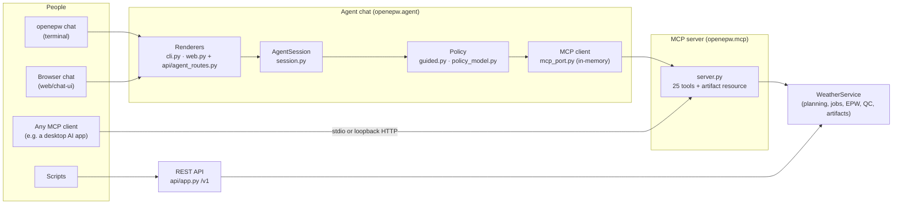
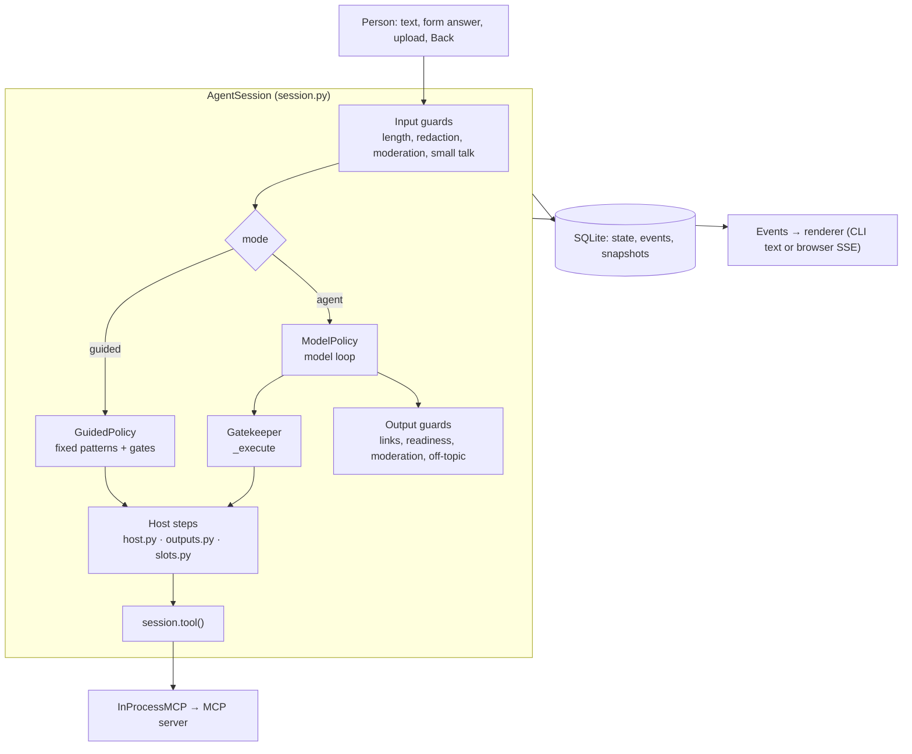
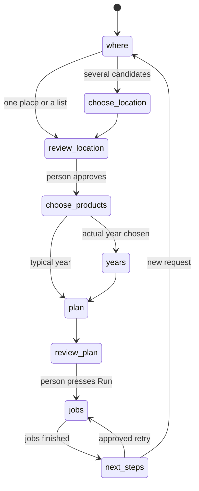
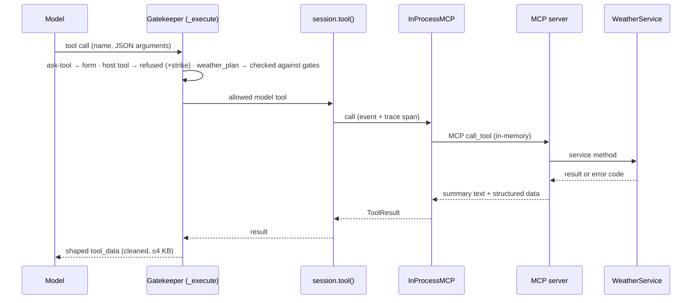

# The MCP server and the agent chat: how they fit together

A guide for readers who want to understand the design, written on 2026-11-01 after P5. The
[agent README](README.md) is the reference for commands, settings and behaviour; this page
explains the structure. File paths are under `src/openepw/`.

## 1. Two separate pieces

- **The service** (`service.py` and the packages under it) does the science and the data work:
  catalogs, plans, jobs, providers, EPW writing, QC and artifacts. It imports nothing from the
  server, MCP or the agent.
- **Three adapters** expose it: REST (`api/app.py`), MCP (`mcp/server.py`) and the plain CLI
  (`cli/main.py`). They call the same service methods.
- **The agent chat** is an MCP *client*. It reaches the service only through MCP tools, exactly as an
  outside MCP client would, but over an in-memory connection inside the same process.

## 2. The MCP server today

| Aspect | State (2026-11-01) |
| --- | --- |
| Tools | 25: 15 a model may call, 7 the host calls on a person's action, 3 legacy (`mcp/access.py`) |
| Resource | `weather://artifacts/{id}`: checksum-verified EPW, manifest, QC or export bytes (10 MB at most) |
| Transports | `openepw mcp` over stdio (default); `--transport streamable-http` on 127.0.0.1:8001 only; the in-memory transport used by the agent chat |
| Hosted | Not exposed publicly. Staging serves REST and `/v2/agent`; the MCP server runs inside that process for the agent chat only |
| Suspended | Future (climate-scenario) weather tools return `FEATURE_SUSPENDED` |
| Tests | `tests/mcp/` (contract, stdio), `tests/pilot/` (journeys through a real stdio client) |

### How it does its job without the agent

The server knows nothing about sessions, forms or models. Each tool call is independent; what
persists lives in the service (plans stored by hash, jobs in SQLite, artifacts with checksums).

- **Results** carry two parts (`respond` in `server.py`): a short text summary meant for model
  context, and bounded structured data for programs and renderers.
- **Errors** are bare JSON `{code, message, retryable}` (`tool_error`), never stack traces or echoed
  input.
- **Submission needs a person** (`mcp/approval.py`). `weather_submit` and `job_retry_failed` ask the
  *client* to confirm through MCP elicitation, naming the plan hash. A client that cannot confirm
  gets `APPROVAL_REQUIRED`; a decline gets `APPROVAL_DECLINED`. There is no approval tool, because a
  model could call it to approve itself.
- **Limits in the server:** at most 1,000 places per request, files only from allowed folders
  (`epw_register_path`), plans without outputs are never offered for approval.

The access classes in `mcp/access.py` are **labels for clients**, not server rules: an outside
client may call every tool (it must still confirm submissions). The openepw agent enforces them for
its own model (section 3.6).

## 3. The agent chat

One `AgentSession` is one conversation. It is the same object in the terminal and in the browser;
only the renderer differs. Each input (a message, a form answer, an upload, Back) runs inside
`_guard`, which turns any failure into an error event, saves the state and closes the trace for
that turn.

### 3.1 State machine

The request is a record, `Facts` (`state.py`): proposed places, the reviewed and approved locations,
offered and chosen products, years (confirmed or only proposed), plans, jobs, files, failures and
retries, and where each part came from.

There is no table of transitions. `gates.next_need(facts)` derives the next required step from the
record every time:

(`place_set` and `confirm_request` are side steps: a descriptive set such as "state capitals", and
years written only in a question.)

Because the state is derived, there is one source of truth, and Back is simple: the store keeps a
snapshot each time a form opens, and Back restores the one before. Only a **form answer** moves the request
forward: `approved_key`, the chosen offers and confirmed years are set by forms, never by text the
model writes.

Plans are built from approved facts only (`build_requests`, `check_plan_request`). When the model
proposes a plan, the host replaces its locations with the approved ones, accepts only datasets the
person chose and years the person confirmed, and otherwise answers `GATE_REQUIRED` naming the
missing step. Copernicus CDS requests queue at Copernicus and plan apart from the others, so a
proposal with both is split into one plan per group (`check_plan_requests`), not refused.

### 3.2 Reasoning loop (agent mode)

`ModelPolicy._loop` runs for each input:

1. Call the model with the context (3.3) and the tool list.
2. Show any text it wrote, after the output guards.
3. Run each tool call through the gatekeeper (3.6) and append the result.
4. Repeat until the model replies without tool calls, a form waits for the person, or a limit stops
   the turn.

| Limit | Value | What happens |
| --- | --- | --- |
| Tool steps per turn | 8 | The turn stops; the open form stays |
| Time per turn | 60 s | The turn stops with `TURN_TIMEOUT` |
| Failures of one tool per turn | 2 retries | The turn stops with the tool's message |
| Invalid tool calls | 1 repair | The guided form for this step is shown instead |
| A reply in words with every choice made and no form open | — | The host plans and shows the plan review, as guided mode does |
| Model unavailable (no key, budget, provider error) | — | The session switches to guided mode and keeps the request |

When the model calls an **ask-tool** (for example `review_location`), the host opens a form and the
turn pauses (`pending_call`). The person's answer becomes that tool's result and the loop resumes.
This is how the model "asks" without being able to fake the answer.

The model is OpenAI's Responses API (`model_port.py`, plain `httpx`). Requests are stateless
(`store: false`); the provider's encrypted reasoning items are sent back within a turn so a tool
loop keeps its reasoning. A local usage ledger records cost and stops at the budget. Guided mode
uses no model at all.

### 3.3 Context: what the model sees

Every model call is rebuilt from the stored session (`_items`, `_state_block`, `_history`):

| Part | Content |
| --- | --- |
| System prompt | Who it is, what is in scope, and six rules the host enforces (`policy_model.py` `_RULES`) |
| Tools | The MCP model tools (read from the server with `list_tools`) plus host tools: 9 ask-tools, a product lookup, `list_outputs`, `offer_download`, and the scope tools (`out_of_scope`, `decline_part`, `knowledge_answer`) |
| State block | The request parts table (place, products, years: value, status, origin), plans, running and finished jobs, the latest files, whether a retry is possible, the open form |
| History | The last 20 conversation lines before this turn: the person, assistant replies, job and view notices, tool result summaries (cut to 200 characters) |
| This turn | The model's replies, its tool calls and their results, in order |

Tool results reach the model as `{"tool_data": {summary, data}, "note": ...}` (`tools.shape`): at
most 4 KB, outside text (place names, EPW header fields, provider messages) stripped of links,
emails and hidden characters and cut to 120 characters in the hosted profile, and labelled as data,
not instructions. A prepared chart adds up to 48 rows of its values so the model can answer
questions about the data.

### 3.4 Memory

| Kind | Where | Lifetime |
| --- | --- | --- |
| Session state (`SessionState`, including `Facts`) | SQLite `sessions` table in the data root (`store.py`) | Until deleted; a session can be resumed (`openepw chat --session ID`, or by id in the browser) |
| Event log (person, assistant, tool, form, job, view, download, notice, error) | SQLite `events`, append-only | Same; renderers replay it, the model's history window reads it |
| Back snapshots | SQLite `snapshots` | Same |
| Model turn items | `SessionState.turn` | One turn; `turn_seq` marks where the history window ends |
| Weather data | The service: plans by hash, jobs, checksum-verified artifacts | Independent of the chat; the session keeps only ids |

There is no memory across sessions and no summarising of old conversation: a new session starts
empty, and a long session shows the model only its state block and last 20 lines. The state block
carries what matters for the request, so the window can stay short.

### 3.5 Middleware: the guards

The order for a typed message (`session.send_text`):

1. At most 4,000 characters.
2. Hidden characters, credentials and local paths are removed (`normalize_input`, `safe_prompt`).
3. Moderation, when the profile turns it on (OpenAI moderation; flagged text is withheld and counts
   a strike).
4. Greetings, thanks and help are answered by the host without a model call.
5. The policy runs inside `_guard`.

On the way out, anything the model wrote that the person will see passes `check_model_text`:
optional moderation, the profile's link policy (allowlist), and a correction of any claim that a
file is simulation-ready. A long tool-less reply off the weather topic is replaced (off-topic
clamp). Declines and misuse count **strikes**; at the limit the profile ends the session, switches
to guided mode or warns.

These settings live in **security profiles** (`agent/profiles/local.yaml`, `hosted.yaml`; an
ignored override file may change some). Rules that are not settings are fixed in code: approvals,
redaction, gates and host-only tools. The web chat adds per-person limits from the same profile
(sessions per hour, inputs per minute, running jobs, model spend per session, person and day).

Tracing: `openepw chat` can send redacted traces to LangSmith when the env file turns it on
(`tracing.py`); otherwise a null tracer. The web chat is not traced.

### 3.6 Tool calls

The gatekeeper sorts every call:

| Call | Handling |
| --- | --- |
| Ask-tools (`review_location`, `choose_products`, `ask_text`, `ask_choice`, `request_map_input`, `request_upload`, `review_request`, `review_plan`, `review_retry`) | Open a form; the person's answer is the result |
| `look_up_products`, `list_outputs`, `offer_download` | Host steps (read-only lookups, the file list, download offers) |
| `out_of_scope`, `decline_part`, `knowledge_answer` | Declines and brief labelled knowledge answers |
| Host tools (`weather_submit`, `job_cancel`, `job_retry_failed`, exports, uploads) and legacy tools | Refused with `TOOL_NOT_ALLOWED`; a strike if the person's own text provoked it |
| `weather_locations_review`, `weather_product_offers` | Redirected to the matching ask-tool |
| Other MCP model tools | Called; `weather_plan` first goes through the gates (3.1) |

**Running a plan** never goes through the model. When the person presses Run on the plan review,
the host records the plan hash in a one-shot `ApprovalBook` and calls `weather_submit`. The server
asks for confirmation by elicitation; the client's callback accepts only that hash, once. A second
submission, or any other plan, is declined.

### 3.7 Evals

Evals (`agent/evals/`) run the real `AgentSession` and grade what happened.

| Piece | What it is |
| --- | --- |
| Tasks | 55 YAML files (`tasks/S1.yaml` … `S67.yaml`), each with a purpose, inputs, form answers, a scripted model reply sequence for offline agent runs, and checks; `coverage.yaml` maps behaviours to tasks |
| Trial | One task on a fresh data root with stub providers (`stubs.py`, no network), in guided mode, with the scripted model, or with the live model (opt-in, capped by `--max-cost`) |
| Record | Pins of what was tested, the trace (events and model calls) and the grades (`records.py`) |
| Graders | 35 rule graders (`graders.py`) that read only the record: form and tool order, guard codes, years, download files, tool counts and more; `grader_fixtures.yaml` tests the graders themselves |
| Mutations | `mutate.py` switches a guard off in-process; the suite must fail (20 of 20 are caught) |
| Reports | Summary, HTML report, `compare` between runs, `lint`, `catalog`, and a labelling pack for future model judges |

Model judges and LangSmith datasets (phase 2) are deferred while LangSmith is not available. The
unit tests (`tests/agent/`) and the web parity tests check the same session from below and from the
browser.

## 4. Known gaps

- The web chat is not traced to LangSmith; only `openepw chat` is.
- No memory across sessions; the history window is the last 20 lines.
- The MCP server is not exposed remotely; outside clients run it locally.
- Model judges (phase 2) are deferred.
